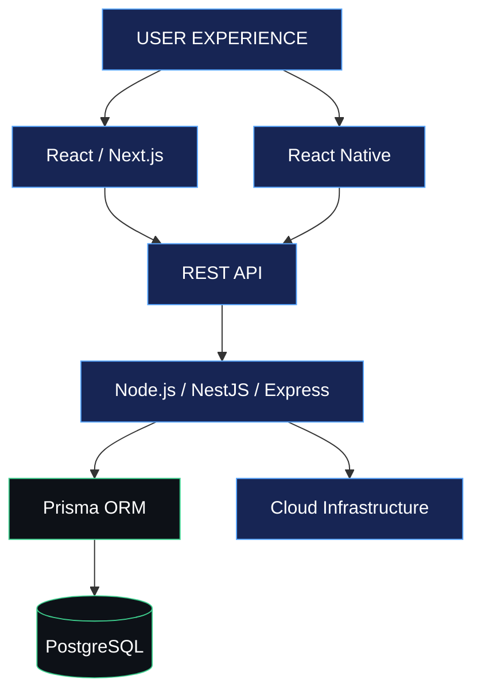

<div align="center">


<br/>

<kbd>FULL-STACK DEVELOPMENT</kbd>
<kbd>20 YEARS OLD</kbd>
<kbd>DR CONGO</kbd>

</div>

---

## 01 — Developer Identity


I'm **Son Altesse**, a 20-year-old full-stack developer specializing in the JavaScript and TypeScript ecosystem.

I design and develop modern web applications, mobile experiences, backend services and digital platforms.

My approach combines software architecture, performance, maintainability and product thinking.

**I don't just write code. I turn ideas into working systems.**

<br clear="all" />

```typescript
class SonAltesse {
  readonly age = 20;
  readonly username = "Chadro14";
  readonly role = "Full-Stack Developer";
  readonly studio = "Xelira Studio";

  readonly expertise = {
    languages: ["JavaScript", "TypeScript"],
    frontend: ["React", "Next.js"],
    mobile: ["React Native"],
    backend: ["Node.js", "Express", "NestJS"],
    database: ["SQL", "PostgreSQL"],
    automation: ["Shell", "Bash"]
  };

  readonly principles = [
    "Clean Architecture",
    "Performance",
    "Security",
    "Scalability"
  ];

  build(): string {
    return "Transforming complexity into functional systems.";
  }
}
```

---

## 02 — Engineering Arsenal

<div align="center">


</div>

<table>
<tr>
<td width="24%"><strong>LANGUAGES</strong></td>
<td width="40%">

</td>
<td>JavaScript · TypeScript</td>
</tr>

<tr>
<td><strong>FRONTEND</strong></td>
<td>

</td>
<td>React · Next.js · Tailwind CSS</td>
</tr>

<tr>
<td><strong>MOBILE</strong></td>
<td>

</td>
<td>React Native</td>
</tr>

<tr>
<td><strong>BACKEND</strong></td>
<td>

</td>
<td>Node.js · Express · NestJS</td>
</tr>

<tr>
<td><strong>DATA LAYER</strong></td>
<td>

</td>
<td>SQL · PostgreSQL · Prisma</td>
</tr>

<tr>
<td><strong>INFRASTRUCTURE</strong></td>
<td>

</td>
<td>Shell · Linux · Deployment</td>
</tr>

<tr>
<td><strong>DEVELOPMENT</strong></td>
<td>

</td>
<td>Version Control · Development Tools</td>
</tr>
</table>

---

## 03 — System Architecture

<div align="center">



<sub>Conceptual architecture — from interface to infrastructure.</sub>

</div>

---

## 04 — Selected Productions

<table>
<tr>
<td width="50%" valign="top">

### INKdrop

**Digital Publishing & Social Platform**

A digital ecosystem connecting manga creators and readers through publishing, communication and content discovery.

**Technical ecosystem**


<br/><br/>

- Multilingual interfaces
- Digital publishing
- Social interactions
- Subscription infrastructure
- AI-powered features

<a href="https://ink-drop.app">

</a>

</td>
<td width="50%" valign="top">

### Bot Connect

**Automation & Management Platform**

A centralized platform for managing WhatsApp bots, account connections and subscription services.

**Technical ecosystem**


<br/><br/>

- Account linking
- Session management
- Payment integration
- Administration dashboard
- Subscription management

<a href="https://xelira-bot.vercel.app">

</a>

</td>
</tr>
</table>

---

## 05 — GitHub Intelligence

<div align="center">


<br/>


<br/>


</div>

---

## 06 — Engineering Philosophy

<div align="center">


<br/>

**LOGIC — ARCHITECTURE — EXECUTION**

</div>

---

<div align="center">

### SON ALTESSE

**Full-Stack Developer · Xelira Studio**

<a href="https://github.com/Chadro14">

</a>

<br/><br/>

<sub>DESIGNED TO BUILD. ENGINEERED TO EVOLVE.</sub>

<br/>


</div>
